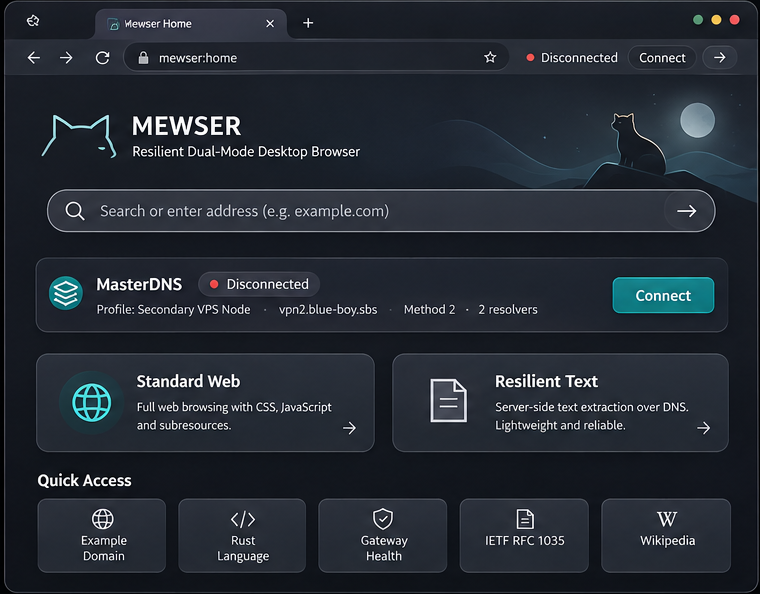
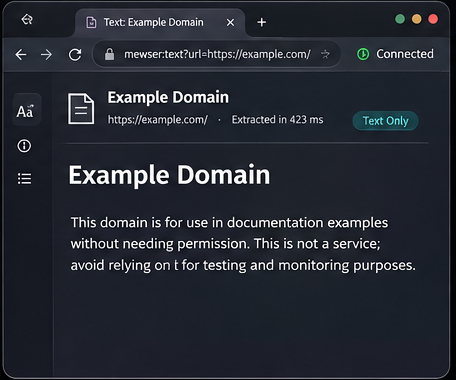
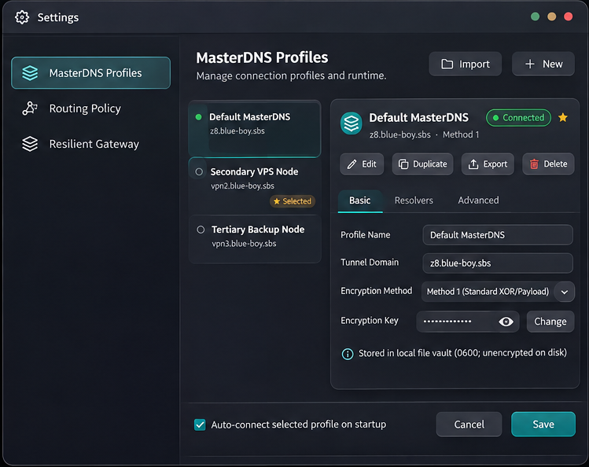
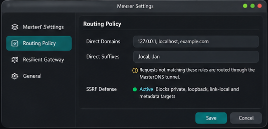
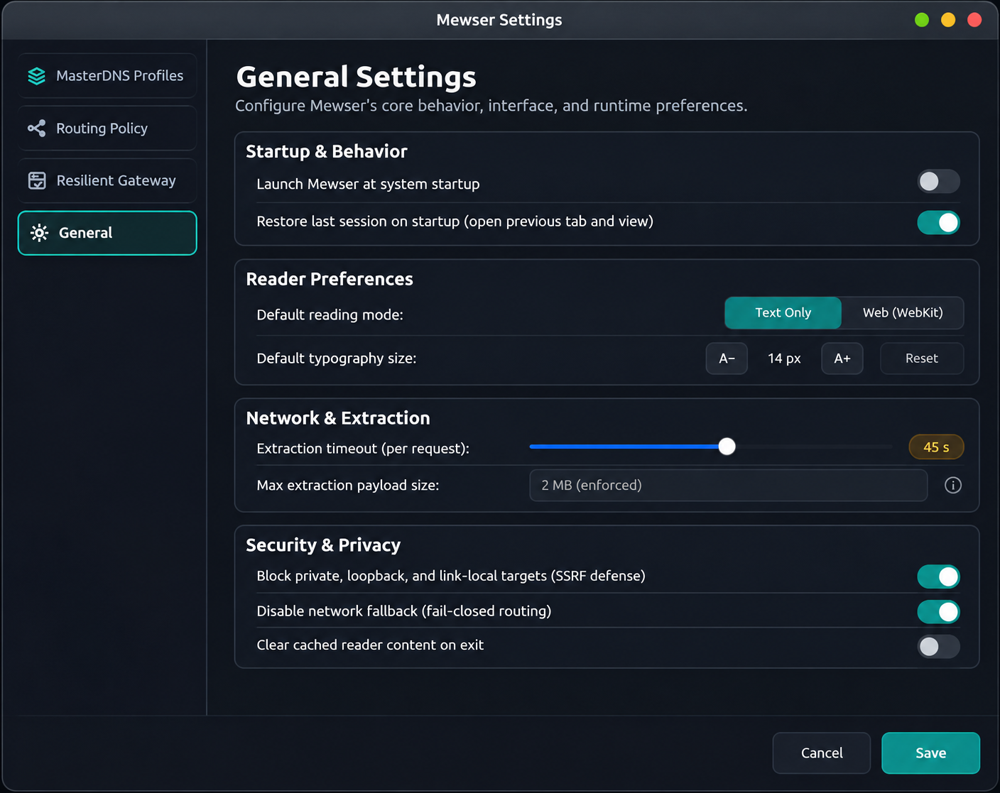

# Mewser

Mewser is a dual-mode web browser engineered for censored, throttled, and bandwidth-constrained network environments.

It pairs direct web browsing with a resilient, server-assisted text extraction engine that routes page requests over encrypted DNS tunnels (via MasterDNS) to a user-operated, self-hosted Gateway.

---

## Current Release

| Artifact | Target Platform | Format | Download |
|---|---|---|---|
| **Mewser Desktop** | Linux `x86_64` | Debian Package (`.deb`) | [mewser-desktop_0.1.1_amd64.deb](https://github.com/arshiacomplus/Mewser/releases/download/v0.1.1/mewser-desktop_0.1.1_amd64.deb) |
| **Mewser Desktop** | Linux `x86_64` | Generic Distribution Archive (`.tar.gz`) | [mewser-desktop-0.1.1-linux-x86_64.tar.gz](https://github.com/arshiacomplus/Mewser/releases/download/v0.1.1/mewser-desktop-0.1.1-linux-x86_64.tar.gz) |
| **Mewser Gateway** | Linux `x86_64` (Server) | Standalone Server Package (`.tar.gz`) | [mewser-gateway-0.1.1-linux-x86_64.tar.gz](https://github.com/arshiacomplus/Mewser/releases/download/v0.1.1/mewser-gateway-0.1.1-linux-x86_64.tar.gz) |
| **Gateway Bootstrap Installer** | Linux `x86_64` (Server) | Standalone Installer Script (`.sh`) | [install-gateway.sh](https://github.com/arshiacomplus/Mewser/releases/download/v0.1.1/install-gateway.sh) |
| **Integrity Manifest** | All Artifacts | SHA-256 Checksums | [SHA256SUMS](https://github.com/arshiacomplus/Mewser/releases/download/v0.1.1/SHA256SUMS) |

Release tags, changelogs, and release signatures are published on the [GitHub Releases page](https://github.com/arshiacomplus/Mewser/releases).

---

## How Mewser Works

Mewser provides two distinct browsing modes selectable directly from the navigation bar:

### 1. Standard Web Mode
Full web engine powered by GTK 3 and WebKitGTK 4.1. Standard Web mode renders modern web pages, CSS, client-side JavaScript, and media directly through your local network interface or through an optional local proxy.

### 2. Resilient Text Mode
A text-first browsing pipeline designed for severe network throttling, protocol-level censorship, and intermittent connectivity.

When you request a page in Resilient Text mode:
1. The desktop client sends an extraction request over your encrypted DNS tunnel (via MasterDNS) to your self-hosted Mewser Gateway.
2. The Gateway fetches the remote website, enforces strict server-side request forgery (SSRF) defenses, strips JavaScript, advertisements, tracking beacons, and inline styles, and extracts structured article text and hyperlinks.
3. The extracted document is compressed and returned through the DNS tunnel.
4. Mewser Desktop renders clean, readable typography with full hyperlink navigation. Media assets are never auto-fetched, reducing payload sizes by up to 95%.

```
┌────────────────────────────────────────────────────────────────────────┐
│ STANDARD WEB MODE                                                      │
│ [Mewser Desktop] ── Direct HTTPS ──► [Target Web Server]               │
└────────────────────────────────────────────────────────────────────────┘

┌────────────────────────────────────────────────────────────────────────┐
│ RESILIENT TEXT MODE                                                    │
│ [Mewser Desktop]                                                       │
│   │                                                                    │
│   ▼ (Local Loopback)                                                   │
│ [Local MasterDNS Client] (127.0.0.1:1080)                              │
│   │                                                                    │
│   ▼ (Encrypted DNS Tunnel over UDP Port 53)                            │
│ [Remote MasterDNS Server]                                              │
│   │                                                                    │
│   ▼ (Local Loopback Forwarding)                                        │
│ [Mewser Gateway Daemon] (127.0.0.1:4040)                               │
│   │                                                                    │
│   ▼ (Outbound HTTPS Article Extraction)                                │
│ [Target Web Server]                                                    │
└────────────────────────────────────────────────────────────────────────┘
```

### Self-Hosted Infrastructure Model
Mewser is fully self-hosted. There is no shared, centralized, or developer-operated Gateway backend. Every operator deploys their own Gateway daemon on an independent VPS or server instance alongside MasterDNS. This design prevents traffic correlation, eliminates shared infrastructure chokepoints, and gives users complete control over their credentials.

---

## User Interface

### Home Dashboard
The initial dashboard provides an integrated address bar, quick-access controls, and a persistent mode toggle badge (`[Standard]` / `[Resilient]`):



### Resilient Text Reader
Optimized readability layout for extracted articles with link navigation, reading controls, and offline document caching:



### MasterDNS Profile Manager
Configures, imports, and validates MasterDNS tunnel runtime profiles and resolver endpoints:



### Routing Policy Settings
Configures domain routing lists, explicit proxy routes, and fail-closed security rules:



### General Settings
Manages application timeouts, default browser modes, local cache limits, and theme appearance:



---

## Desktop Installation (Linux x86_64)

### System Requirements
- **Architecture**: Linux `x86_64`
- **Toolkit**: GTK 3 (`libgtk-3-0` >= 3.24.0 or `libgtk-3-0t64` >= 3.24.0)
- **Web Engine**: WebKitGTK 4.1 (`libwebkit2gtk-4.1-0` >= 2.40.0)
- **HTTP Engine**: libsoup 3 (`libsoup-3.0-0` >= 3.0.0)
- **C Library**: `glibc >= 2.34`

### Option 1: Debian / Ubuntu Package (`.deb`)
Download the `.deb` package from the latest release and install it with `apt`:

```bash
# Download debian package
curl -fsSL -O https://github.com/arshiacomplus/Mewser/releases/download/v0.1.1/mewser-desktop_0.1.1_amd64.deb

# Install package and dependencies
sudo apt update
sudo apt install ./mewser-desktop_0.1.1_amd64.deb
```

Launch the browser from your application launcher or by running:
```bash
mewser-desktop
```

### Option 2: Generic Linux Archive (`.tar.gz`)
On other distributions (Arch Linux, Fedora, openSUSE), use the generic archive:

```bash
curl -fsSL -O https://github.com/arshiacomplus/Mewser/releases/download/v0.1.1/mewser-desktop-0.1.1-linux-x86_64.tar.gz
tar -xzf mewser-desktop-0.1.1-linux-x86_64.tar.gz
cd mewser-desktop-linux-x86_64

# System-wide installation (requires sudo):
sudo ./install.sh

# Or user-local installation (no root required):
./install.sh --user
```

---

## Self-Hosted Gateway Installation (Linux Server)

The Gateway daemon runs alongside your MasterDNS server on an unprivileged systemd service.

### Quick Guided Installation (Recommended)
Download and inspect the official standalone installation script on your server:

```bash
# 1. Download official bootstrap installer and integrity manifest
# (Available as a standalone versioned asset starting with v0.1.1)
curl -fsSL -O https://github.com/arshiacomplus/Mewser/releases/download/v0.1.1/install-gateway.sh
curl -fsSL -O https://github.com/arshiacomplus/Mewser/releases/download/v0.1.1/SHA256SUMS

# Verify SHA-256 integrity against the release manifest
sha256sum --ignore-missing -c SHA256SUMS

# Alternatively, obtain the installer directly from the repository main branch:
# curl -fsSL -O https://raw.githubusercontent.com/arshiacomplus/Mewser/main/scripts/install-gateway.sh

# 2. Inspect the script content before execution (security best practice; never pipe curl to bash)
less install-gateway.sh

# 3. Make executable and run with root privileges
chmod +x install-gateway.sh
sudo ./install-gateway.sh
```

The installer verifies archive checksums, detects local interface IP assignments, guides you through topology selection, installs systemd service units, and generates a secure 64-character Bearer token (stored safely in `/etc/mewser-gateway/gateway.env` mode 0600).

> [!IMPORTANT]
> **Token Secrecy**: The generated Bearer token is never printed in routine installation summaries or `deploy-gateway.sh status` logs. Retrieve it securely using `sudo deploy-gateway.sh show-token`.

### Non-Interactive Installation
For automated server provisioning, specify your topology directly:

```bash
# Topology A: Fixed TCP + Loopback (Recommended for all cloud providers, including 1:1 NAT):
sudo ./install-gateway.sh -t fixed-tcp -y

# Topology B: SOCKS5 with Firewall Isolation (Supported ONLY when public IPv4 is directly on local interface):
sudo ./install-gateway.sh -t socks5 -i <SERVER_PUBLIC_IP> --confirm-firewall -y
```

### Gateway Service Management
After installation, manage the service using the installed control helper:

```bash
# Check service status, bind address, and local health (reports token configuration, not secret value)
sudo deploy-gateway.sh status

# Securely display the active 64-character Bearer authentication token
sudo deploy-gateway.sh show-token

# Update the Gateway binary while preserving credentials and configuration
sudo deploy-gateway.sh update

# Safely uninstall service and binaries
sudo deploy-gateway.sh uninstall
```

---

## Connecting Desktop to Your Gateway

1. On your VPS, securely retrieve your Gateway Bearer authentication token:
   ```bash
   sudo deploy-gateway.sh show-token
   ```
2. Launch **Mewser Desktop** and navigate to **Settings -> Resilient Gateway**.
3. Configure your deployment parameters:
   - **Fixed TCP (Recommended)**:
     - Set **Transport Protocol** to `Fixed TCP`.
     - Set **Fixed TCP Listener** to `127.0.0.1:1080` (your local MasterDNS client listener).
     - Ensure your server MasterDNS configuration (`server_config.toml`) contains:
       ```toml
       PROTOCOL_TYPE = "TCP"
       FORWARD_IP = "127.0.0.1"
       FORWARD_PORT = 4040
       ```
   - **SOCKS5**:
     - Set **Transport Protocol** to `SOCKS5`.
     - Set **SOCKS5 Proxy** to `127.0.0.1:1080`.
     - Set **Remote Gateway** to `<SERVER_PUBLIC_IP>:4040`.
     - Ensure your server MasterDNS configuration (`server_config.toml`) contains:
       ```toml
       PROTOCOL_TYPE = "SOCKS5"
       ```
4. Paste the 64-character token into the **Gateway Authentication Token** field.
5. In the browser address bar, switch the mode badge from `[Standard]` to `[Resilient]` to browse through your tunnel.

---

## Deployment Topologies

| Feature | Topology A (Fixed TCP) | Topology B (SOCKS5) |
|---|---|---|
| **Recommended For** | **All environments** (AWS, GCP, Azure, Hetzner, Bare-Metal) | Hosts with public IP directly assigned to `eth0` |
| **1:1 NAT Cloud Compatibility** | **Fully supported** (Loopback-only communication) | **Unsupported** (Private IP interfaces fail validation) |
| **Gateway Socket Bind** | `127.0.0.1:4040` (Strictly loopback) | `<SERVER_PUBLIC_IP>:4040` |
| **External Internet Port Exposure** | Zero (Port 4040 is not reachable from WAN) | Isolated via `iptables ! -i lo -j REJECT` rule |
| **MasterDNS Server Mode** | `PROTOCOL_TYPE = "TCP"` | `PROTOCOL_TYPE = "SOCKS5"` |
| **MasterDNS Forwarding** | `127.0.0.1:4040` | Kernel loopback routing via public IP |

Detailed networking recipes, firewall configuration rules, and manual deployment instructions are available in [docs/deployment/self-hosted-gateway.md](docs/deployment/self-hosted-gateway.md).

---

## Platform Support Matrix

| Platform | Component | Status | Notes |
|---|---|---|---|
| **Linux (x86_64)** | Mewser Desktop | **Available (v0.1.1)** | GTK 3 + WebKitGTK 4.1 desktop application |
| **Linux (x86_64)** | Mewser Gateway | **Available (v0.1.1)** | Systemd service daemon with pure Rust TLS |
| **Windows** | Mewser Desktop | Planned / Roadmap | WinUI 3 + WebView2 client frontend |
| **Android** | Mewser Mobile | Planned / Roadmap | Jetpack Compose client frontend |
| **Apple (macOS / iOS)** | All Components | Out of Scope | Not supported |

---

## Security Model & Invariants

1. **Explicit Routing & Fail-Closed Transport**:
   If a destination is routed through the tunnel in Resilient Text mode, tunnel failures never silently fall back to direct connections. Failing closed prevents traffic and DNS leaks under active network surveillance.
2. **Server-Side SSRF Defenses**:
   Mewser Gateway inspects all target URLs and DNS resolutions before making outbound HTTP connections. Requests targeting local loopback (`127.0.0.0/8`), private subnets (RFC 1918 `10.0.0.0/8`, `172.16.0.0/12`, `192.168.0.0/16`), Carrier-Grade NAT (RFC 6598 `100.64.0.0/10`), link-local (`169.254.0.0/16`), and cloud metadata endpoints (`169.254.169.254`, `metadata.google.internal`) are strictly rejected.
3. **Mandatory Token Authentication**:
   Gateway extraction endpoints require constant-time Bearer token verification. Token generation uses a 32-byte cryptographically secure pseudorandom number generator (CSPRNG).
4. **Sandboxed Service Privileges**:
   Mewser Gateway runs under a dedicated unprivileged user (`mewser-gateway`) with `CapabilityBoundingSet=` (zero capabilities), `ProtectSystem=strict`, and `PrivateTmp=true`. Configuration files are restricted to mode `0600` root:root.
5. **No Outbound Media Telemetry**:
   Resilient Text mode strips tracking scripts, web beacons, and embedded third-party trackers during extraction.

---

## Known Limitations

- **Client-Side JavaScript**: Resilient Text mode extracts readable static HTML. Single-page applications (SPAs) that require heavy client-side JavaScript execution to render content may not display properly in Resilient mode. Use Standard Web mode for interactive web applications.
- **Audio & Video Streaming**: Streaming media playback is not supported over DNS tunnel extraction.
- **Form Submissions & Authenticated Sessions**: Resilient Text mode is designed for read-only document browsing. Web logins, session cookies, and interactive form submissions should be conducted in Standard Web mode.

---

## Building from Source

To compile Mewser locally, install the stable Rust toolchain (1.80+):

```bash
# Check code formatting
cargo fmt -- --check

# Run Clippy lints
cargo clippy --workspace --all-targets -- -D warnings

# Execute test suite (180 tests)
cargo test --workspace

# Run Gateway installer verification tests
./tests/installer_verification_tests.sh
./tests/bootstrap_installer_tests.sh

# Build release binaries
cargo build --release -p mewser-desktop
cargo build --release -p mewser-gateway
```

Packaging distribution packages:
```bash
# Build Gateway distribution (.tar.gz)
./scripts/package-gateway.sh

# Build Desktop distribution (.deb and .tar.gz)
./scripts/package-desktop.sh
```

---

## Documentation Index

- [System Architecture](docs/architecture.md)
- [Self-Hosted Gateway Deployment Guide](docs/deployment/self-hosted-gateway.md)
- [Legacy VPS Migration Guide](docs/deployment/legacy-vps-migration.md)
- [Implementation Roadmap](docs/roadmap.md)
- [ADR 0001: Locked MVP Scope](docs/decisions/0001-mvp-scope.md)

---

## Contributing & License

Mewser is open-source software licensed under the **GNU General Public License v3.0** (GPL-3.0). See [LICENSE](LICENSE) for details.
