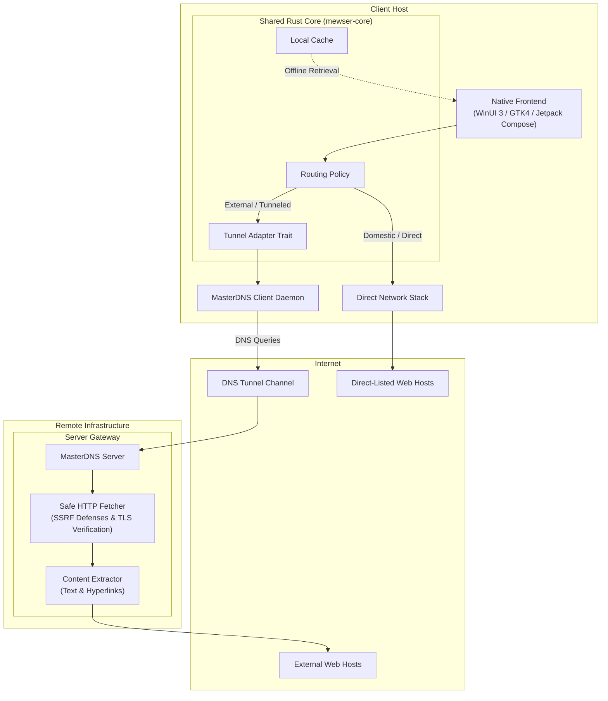
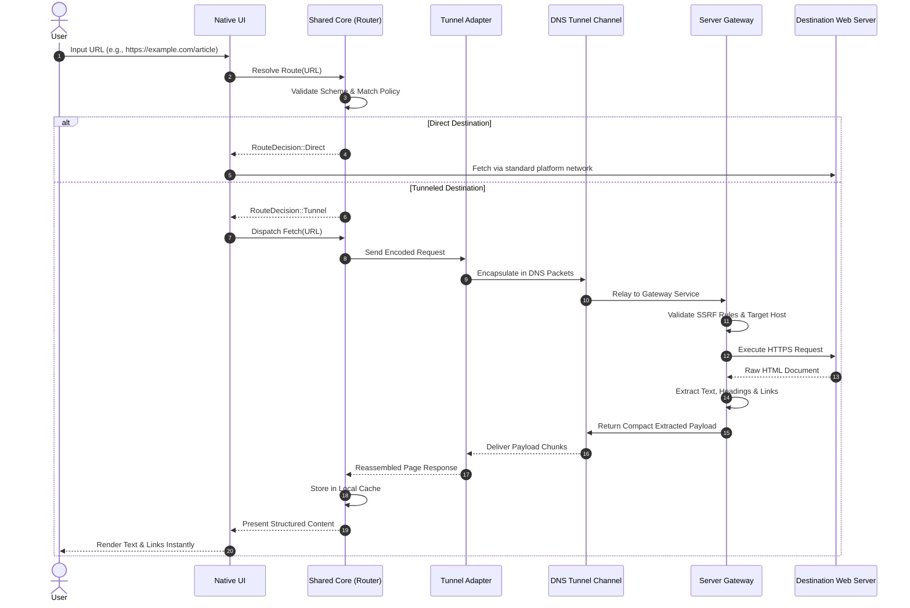

# Mewser Architecture

## 1. System Overview

Mewser is structured as a native client layer sitting atop a shared Rust core, paired with a lightweight remote Server Gateway reached via a DNS tunnel.

## 2. Component Boundaries

### Native Clients
- **Windows**: C# with WinUI 3. Standard web rendering is handled by Microsoft Edge WebView2.
- **Linux**: Rust with GTK4 / libadwaita. Standard web rendering evaluates WebKitGTK.
- **Android**: Kotlin with Jetpack Compose. Standard web rendering uses Android WebView or Mozilla GeckoView.
- **Apple Platforms**: macOS and iOS are explicitly out of scope.

Each native client is responsible exclusively for platform UI lifecycle, input presentation, and native browser embedding. All routing policies, caching rules, and tunnel communications are delegated to the shared core.

### Shared Core (`mewser-core`)
Implemented in Rust to provide memory safety, deterministic resource usage, and clean cross-platform FFI bindings.
- **Routing Engine**: Evaluates user URLs against domestic whitelists and policy rules.
- **Security & Validation**: Enforces scheme limits (`http`/`https`), normalizes hosts, and prevents unsafe address targets.
- **Tunnel Adapter**: Abstract interface decoupling the core from specific MasterDNS daemon or transport details.
- **Content Cache**: Local persistence layer allowing previously fetched pages to remain navigable during offline periods.
- **Network State**: Tracks connectivity status and tunnel availability.

### Server Gateway
A standalone service deployed on remote infrastructure.
- **Safe Fetcher**: Executes HTTP requests on behalf of the client. Strictly validates target IP addresses against private, link-local, loopback, and cloud metadata ranges to prevent Server-Side Request Forgery (SSRF). Enforces strict TLS certificate validation.
- **Content Extractor**: Strips nonessential DOM elements (scripts, stylesheets, tracking beacons, ads, decorative markup) and generates a clean, structured text document with prioritized navigational links.
- **Payload Compressor**: Encodes extracted content into a dense binary or compressed text representation optimized for DNS tunnel MTU constraints.

### MasterDNS Transport
Provides the low-bandwidth, high-latency DNS transport layer. The shared core treats MasterDNS as an abstract byte transport through a well-defined adapter interface. The concrete transport configuration and CLI/daemon mechanics are verified independently before direct integration.

## 3. Operational Modes

### Standard Web Mode
Used for direct-listed domestic sites or when the user explicitly requests full-fidelity browsing over an unconstrained connection. The native frontend utilizes the platform browser engine (WebView2, WebKitGTK, or Android WebView) with standard network capabilities.

### Resilient Text Mode
The primary mode for constrained and disrupted networks.
- Requests pass exclusively through the DNS tunnel to the Gateway.
- The Gateway extracts core readable text, headings, paragraphs, and links.
- The native client renders structured text immediately without waiting for assets.
- Images are replaced by descriptive placeholders with individual on-demand fetch actions.
- Completed pages are committed to local cache.

## 4. End-to-End Request Flow (Text Mode)

## 5. Security & Architectural Invariants

1. **No Silent Fallback**: If a URL is classified for tunneled routing, any tunnel failure or timeout must result in a clear error. The client must never silently fall back to direct access for tunnel destinations, avoiding traffic leaks.
2. **SSRF Mitigation**: The Gateway enforces strict IP address filtering prior to making external requests. The following ranges are blocked:
   - Loopback (`127.0.0.0/8`, `::1`)
   - Private networks (`10.0.0.0/8`, `172.16.0.0/12`, `192.168.0.0/16`)
   - Link-local addresses (`169.254.0.0/16`, `fe80::/10`)
   - Cloud metadata services (`169.254.169.254`)
   - Unique local IPv6 (`fc00::/7`)
   - Non-routable and broadcast addresses
3. **TLS Validation**: All outbound HTTPS requests executed by the Gateway or direct clients must validate server TLS certificates against standard root stores. Disabling certificate checks is prohibited.
4. **User-Initiated Asset Loading**: Images, stylesheets, and embedded media are never auto-loaded in resilient text mode. Each image is assigned a unique reference; the client fetches it only after explicit user interaction.
5. **Bounded Resource Utilization**: Request timeouts, maximum payload sizes, memory allocations, cache eviction limits, and concurrent fetches are bounded by hard caps.
